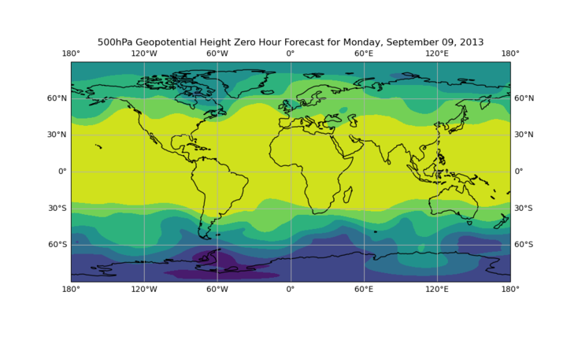

# NavCast — 500 hPa Geopotential Height Prediction

A web application that takes a 12-hour NAVGEM forecast (GRIB file) and uses a
machine-learning regression model to predict the 0-hour 500 hPa analysis.
The result is shown as a map and can be downloaded as a CSV or PNG.



## Architecture

```
Browser ──upload GRIB──▶ web-app (Flask)
                           │  POST /api
                           ▼
                     model-service (Flask + scikit-learn + cfgrib/cartopy)
                           │  POST /submitCsvOut, /submitPngOut
                           ▼
                     web-app serves the map (PNG) and CSV for download
```

The model runs as its own service because its native dependencies
(eccodes, GEOS, PROJ, cartopy) are heavy; this keeps the web front end light.

| Folder | What it contains |
|---|---|
| `web-app/` | Flask + Jinja2 front end (HTML/CSS), file upload and downloads |
| `model-service/` | GRIB parsing, trained regression model, prediction API |
| `docs/` | Screenshots and sample output |

## Run locally

**1. Model service** (terminal 1)
```bash
cd model-service
brew install eccodes geos proj          # Linux: sudo apt install libeccodes-dev libgeos-dev libproj-dev build-essential
pip install -r requirements.txt
flask --app main run --port 5001
```

**2. Web app** (terminal 2)
```bash
cd web-app
pip install -r requirements.txt
flask --app application run --port 5000
```

Open http://127.0.0.1:5000 and upload a NAVGEM GRIB file.

When deployed, set `MODEL_URL` (in web-app) and `APP_URL` (in model-service)
to each service's public address.

## Tech stack

Python · Flask · Jinja2 · scikit-learn · pandas · NumPy · cfgrib · cartopy · matplotlib · HTML/CSS · Heroku (original deployment)

Team Name: Data Stormers

Paola Garcia
Arthur Neumann
Elizabeth Sims
Tyler Wilkie
Stephanie Yee
